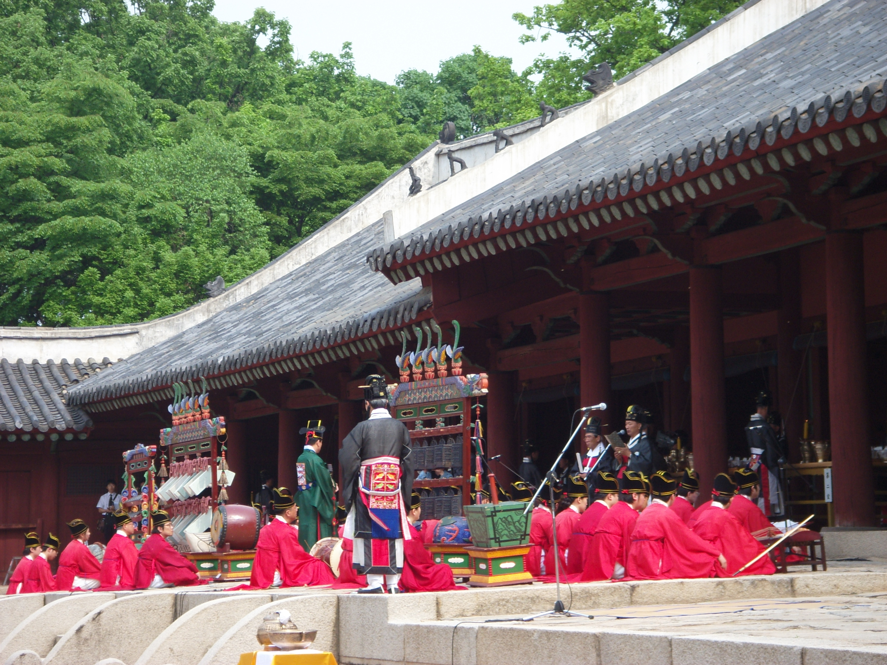

# K-음악의 뿌리를 찾아서!

## 국악 역사 큐레이팅

**중학교 2학년 음악 · 8차시 · 주정화**  
3. 세계 속의 국악의 위상 · 국악 소개하기

> **과거의 소리인 국악은 어떻게 오늘날 K-컬처의 뿌리가 되었으며, 우리는 그 연결 고리 안에서 어떤 미래의 가치를 발견할 수 있을까?**

[상세 수업설계안](docs/unit-plan.md) · [학생 활동지](docs/worksheet.md) · [사진·감상 자료](docs/photos.md) · [출처](docs/sources.md) · [업로드 안내](UPLOAD.md)

## 01 · 익숙한 K-음악에서 탐구 시작하기

학생에게 국악의 역사가 악기 이름과 갈래를 외우는 지식으로만 남지 않도록, 오늘의 음악에서 들리는 전통 요소를 출발점으로 삼는다. **삼국 시대부터 조선 시대까지 무엇이 변했고 무엇이 이어졌는지** 살피며, 국악과 현대 문화의 연결을 근거로 설명한다. ‘연결’과 ‘변화·지속’이라는 개념을 통해 과거의 음악을 오늘의 질문으로 다시 듣는 수업이다.

## 02 · 조사보다 먼저, 실제 소리 듣기

이 단원은 감상 성취기준을 바탕으로 한다. 학생은 대표 음악을 실제로 들은 뒤 악기·갈래·향유 계층·기능·배경을 조사한다. **들어서 발견한 특징과 자료로 확인한 사실을 구분**하고, 유네스코에 등재된 우리 음악 문화유산을 찾아 듣는다. 악기와 연주 장면을 소개하는 사진은 감상을 돕는 자료로 활용한다.

## 03 · 시대 비교 매트릭스로 변화와 지속 찾기

모둠은 시대별 조사 결과를 **시대 × 음악 요소 비교 매트릭스**로 통합한다. 변화는 파랑, 지속은 회색으로 표시하고, 악기 편성·연주 공간·향유 계층·기능을 가로질러 관계를 찾는다. 사실과 출처를 정확히 채우는 데서 나아가 “왜 달라졌을까?”를 사회·문화적 배경과 연결하며, 해석을 뒷받침하는 사례를 고른다.

## 04 · 우리 해석을 먼저 쓰고 AI와 비교하기

학생은 AI 답을 보기 전에 변화의 원인에 대한 모둠 해석을 먼저 쓴다. 이후 Gem의 해석과 비교해 **같은 점·다른 점·근거 없는 점**을 찾고 사료로 교차 검증한다. “음악은 시대에 따라 ○○하지만, ○○은 지속된다”는 일반화 문장을 만들고 사실 사례 두 가지로 뒷받침한다. AI는 비교와 확인의 보조 도구이며 판단과 핵심 메시지는 학생이 결정한다.

## 05 · 청중에게 닿는 전통음악 큐레이팅

학생은 수업 속 가상 역할인 **‘전통음악 홍보 큐레이터’**가 되어 외국인 관광객 또는 초등학생 후배를 청중으로 선택한다. 일반화 문장을 핵심 메시지로 삼아 **카드뉴스 10~20장 또는 홍보 영상 1~3분**을 제작한다. 과거와 현재의 정보를 나란히 놓는 데 그치지 않고, 두 음악 사이의 연결을 청중이 이해할 수 있도록 재구성한다.

## 06 · 발표와 피드백으로 가치를 다시 생각하기

패들렛 초안을 바탕으로 동료의 좋은 점과 수정 제안을 나누고, 발표와 질의응답에서 해석의 근거를 확인한다. 마지막에는 **원형 보존과 현대적 재해석 중 무엇이 국악을 알리는 데 효과적인지** 토의한다. 학생은 5분 성찰 일지에 새로 안 사실·바뀐 생각·국악을 대하는 태도를 기록하며 자신이 만든 메시지를 돌아본다.

## 8차시 한눈에 보기

| 차시 | 탐구 단계 | 주요 활동·결과물 |
| --- | --- | --- |
| 1 | 관계 맺기 | 현대 음악 속 국악 요소 감상, 사전 응답, 담당 시대와 역할 정하기 |
| 2~3 | 조사하기 | 실음 감상, 신뢰 자료 조사, 출처 기록, 국악 인식 설문 |
| 4 | 정리하기 | 모둠 자료를 시대 비교 매트릭스로 통합 |
| 5 · 본시 | 일반화하기 | 변화·지속 찾기, 모둠 해석과 AI 비교, 사례 두 가지로 일반화 |
| 6~7 | 전이하기 | 청중 선택, 카드뉴스·영상 초안, 동료 피드백과 수정 |
| 8 | 발표·성찰 | 큐레이팅 발표, 근거 기반 질의응답, 보존·재해석 토의, 5분 성찰 |

## 배움의 증거와 평가

| 평가 요소 | 배점 | 핵심 증거 |
| --- | ---: | --- |
| 데이터 수집·분류 | 30 | 사실과 출처를 갖춘 시대 비교 매트릭스 |
| 의미 해석 | 30 | 전통 요소와 현대 음악의 연결을 설명하는 논리 |
| 구조화·시각화 | 20 | 규격·청중의 눈높이·논리적 흐름을 갖춘 홍보물 |
| 태도·가치 | 20 | 청중과 소통하고 국악의 가치를 나누는 발표 |
| **합계** | **100** | **과제 1: 30점 + 과제 2: 70점** |

*동료평가는 피드백 자료로 활용한다. 성취도 구분과 세부 기준은 [상세 루브릭](docs/unit-plan.md#3-단원-평가-계획)에 수록했다.*

## 관련 공연 사진

*joonghijung, 「Korean Royal Ancestral Ritual Music-Jongmyo Jeryeak-01.jpg」, [Wikimedia Commons 원본](https://commons.wikimedia.org/wiki/File:Korean_Royal_Ancestral_Ritual_Music-Jongmyo_Jeryeak-01.jpg), [CC BY 2.0](https://creativecommons.org/licenses/by/2.0/). 사진 내용 변경 없음. 과거 시대의 현장 사진이나 본 수업 사진이 아닌 현대 연행 자료다.*

[사진 2장과 감상 자료 출처 보기](docs/photos.md)

## 함께 제공하는 파일

- [상세 수업설계안](docs/unit-plan.md): 개요·목표·GRASPS 과제·루브릭·8차시 계획·본시 45분 지도안
- [학생 활동지](docs/worksheet.md): 감상·조사·일반화·AI 검증·청중 기획·성찰 양식
- [시대 비교 매트릭스](docs/matrix-template.md): 복사해서 사용할 수 있는 빈 비교표
- [사진·감상 자료](docs/photos.md): 관련 사진, 저작자·라이선스, 공식 감상 자료 링크
- [출처·편집 기록](docs/sources.md), [일러스트 프롬프트](docs/illustration-prompts.md), [업로드 안내](UPLOAD.md)

---

원안: 주정화 / 문서화: 2026-10-10. 일러스트 6장은 AI로 만든 개념 설명용 그림이며 역사 고증 자료가 아니다. ‘국립국악원 소속 큐레이터’와 특별전은 원안의 수업용 가상 상황으로, 실제 기관의 사업·모집·후원을 뜻하지 않는다.
