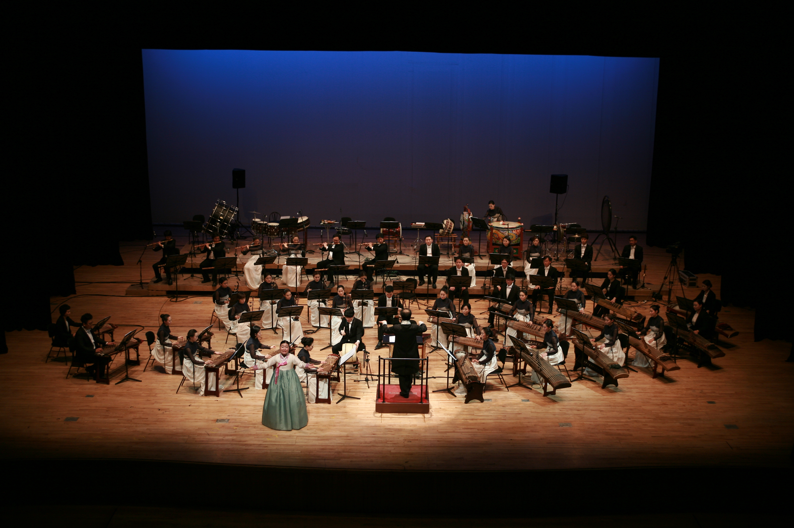

# 사진·감상 자료

[소개](../README.md) · [상세 지도안](unit-plan.md) · [출처 기록](sources.md)

첨부 HWTX에는 본문 사진이 없어 공개된 관련 공연 사진을 선정했습니다. **두 사진은 현대의 연행·공연 모습으로, 삼국~조선 당시의 사진이나 주정화 선생님의 수업 사진이 아닙니다.** 사진은 소리 감상을 대체하지 않습니다.

## 1. 종묘제례악 연행

원본 제목: **Korean Royal Ancestral Ritual Music-Jongmyo Jeryeak-01.jpg**  
저작자: **joonghijung** / 촬영일: 2007-05-06  
출처: [Wikimedia Commons 파일 설명](https://commons.wikimedia.org/wiki/File:Korean_Royal_Ancestral_Ritual_Music-Jongmyo_Jeryeak-01.jpg) · [원 저작자 Flickr](https://www.flickr.com/photos/27114146@N07/2534652507/)  
라이선스: [CC BY 2.0](https://creativecommons.org/licenses/by/2.0/)  
변경: 이미지 내용 변경 없음. 묶음 안의 파일명만 `jongmyo-jeryeak.jpg`로 지정.

**활용 질문:** 사진에서 보이는 연주 공간과 편성은 실제로 들은 음악의 특징과 어떻게 연결되는가? 사진으로 관찰한 것과 자료를 통해 확인해야 하는 것을 구분해 보자.

## 2. 현대 국악관현악 공연

원본 제목: **Pansori img4.JPG**  
저작자: **Soriirang** / 촬영일: 2013-03-07  
원본 설명: 강원도립 국악관현악단 「범피 중류」  
출처: [Wikimedia Commons 파일 설명](https://commons.wikimedia.org/wiki/File:Pansori_img4.JPG) · [저작자 페이지](https://commons.wikimedia.org/wiki/User:Soriirang)  
라이선스: [CC BY-SA 3.0](https://creativecommons.org/licenses/by-sa/3.0/)  
변경: 이미지 내용 변경 없음. 묶음 안의 파일명만 `gugak-orchestra.jpg`로 지정. 이 사진에는 원래의 CC BY-SA 3.0 라이선스를 유지한다.

**활용 질문:** 전통 악기와 오늘의 공연 무대가 어떤 방식으로 만나는지 관찰해 보자. 원본 파일명에 ‘Pansori’가 있지만, 이 사진은 조선 시대 판소리 현장이나 소리꾼·고수만의 전형적 편성을 보여 주는 사진으로 설명하지 않는다.

## 3. 공식 감상·탐구 자료

| 자료 | 수업에서 확인할 내용 |
| --- | --- |
| [UNESCO · 종묘제례와 종묘제례악](https://ich.unesco.org/en/RL/royal-ancestral-ritual-in-the-jongmyo-shrine-and-its-music-00016) | 문화유산 설명과 관련 자료 |
| [UNESCO · 종묘제례와 종묘제례악 영상](https://ich.unesco.org/en/video/41626) | 실제 연행을 듣고 보는 자료 |
| [UNESCO · 판소리](https://ich.unesco.org/en/RL/pansori-epic-chant-00070) | 문화유산 설명과 관련 자료 |

수업에 사용할 곡·연주·구간은 교사가 먼저 확인하고 선정한다. 원안의 5차시는 종묘제례악과 판소리를 각각 30초씩 듣도록 계획되어 있다. 음원·영상 자체를 이 파일 묶음에 복제하지 않고 공식 자료 링크를 제공했다.
