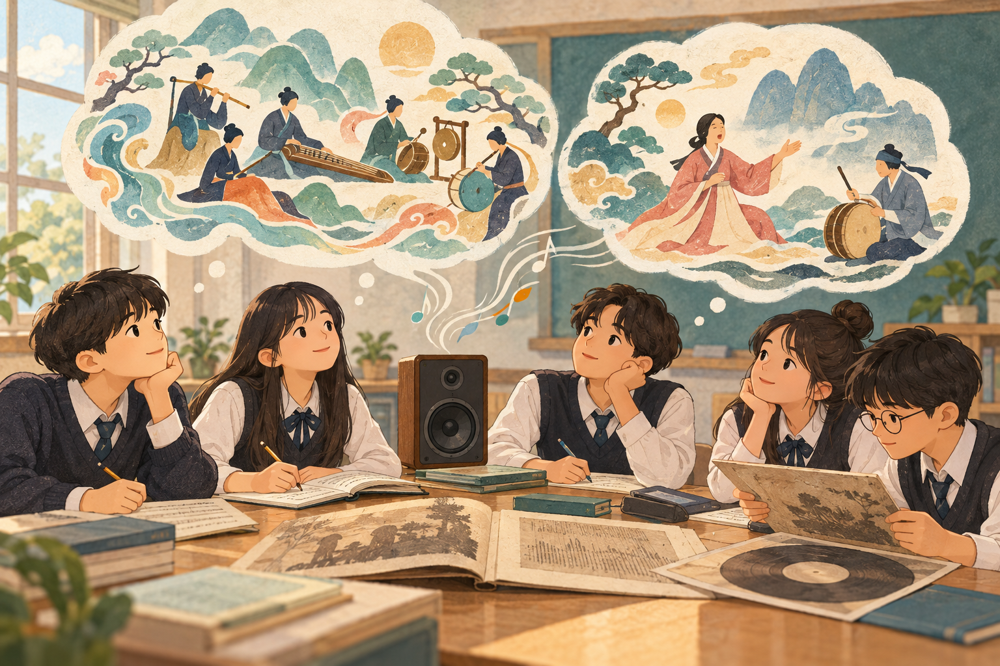
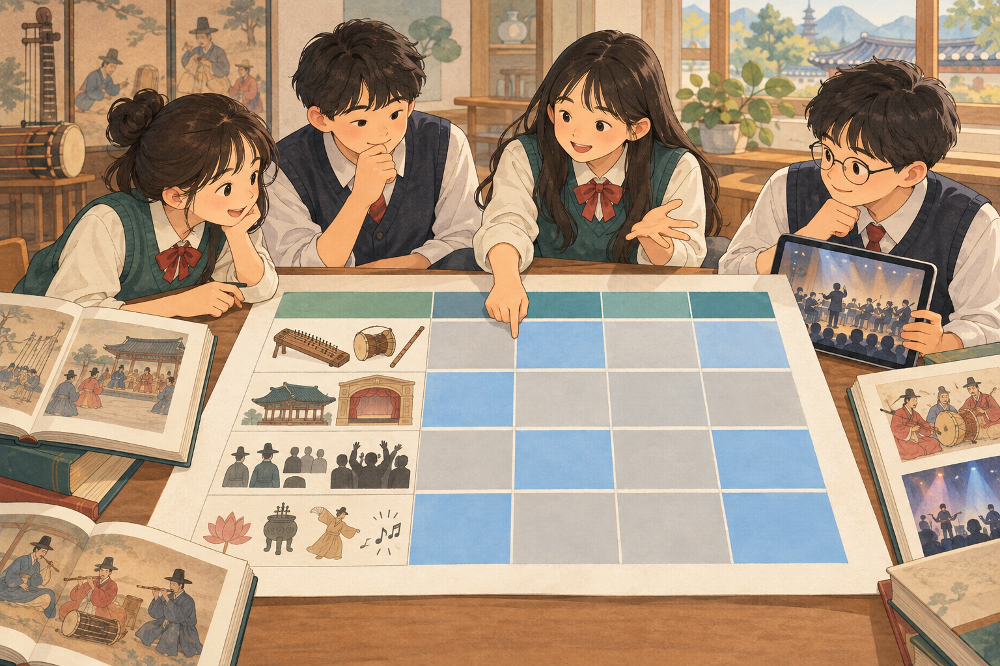
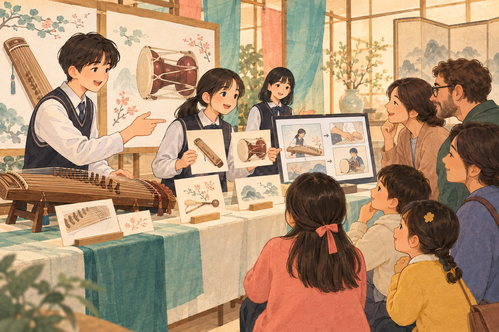
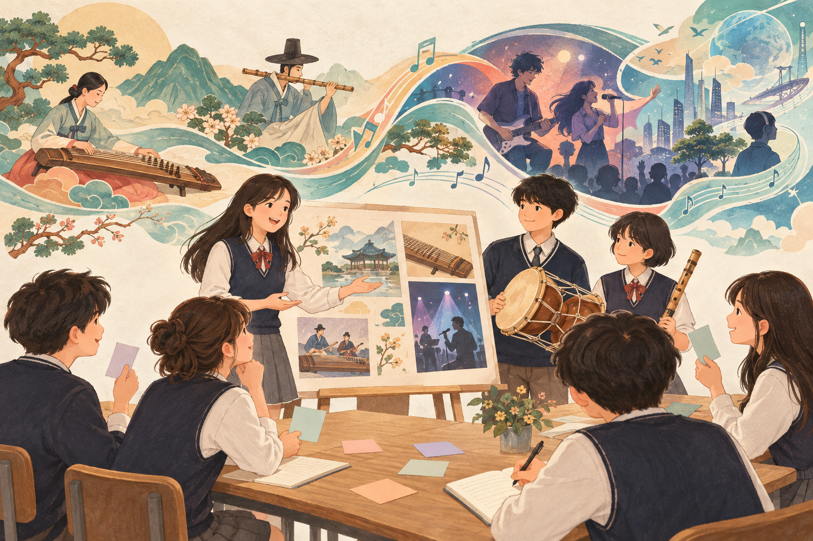

# 단원수업설계안 · 국악 역사 큐레이팅

[소개](../README.md) · [학생 활동지](worksheet.md) · [매트릭스 양식](matrix-template.md)

> 주정화 선생님의 「단원수업설계_국악사큐레이팅_주정화.hwtx」를 Markdown으로 재구성했다. 작성 양식의 안내 문구는 제외하고 원안의 목표·배점·과제 규격·차시·시간을 유지했다. 원안의 역사 해석과 교육과정 표기를 별도 공인 기준으로 새로 검증한 문서는 아니다.

## 1. 단원 설계 개요

| 항목 | 내용 |
| --- | --- |
| 교사 | 주정화 |
| 교과·대상 | 음악 · 중학교 2학년 |
| 총차시 | 8차시 |
| 주제 | K-음악의 뿌리를 찾아서! 국악 역사 큐레이팅 — 3. 세계 속의 국악의 위상 · 국악 소개하기 |
| 교과역량 | 감성(미적 가치 인식), 소통(청중 맞춤 홍보·발표), 공동체(문화유산 계승), 창의성(전통의 현대적 재구성) |
| 핵심역량 | 심미적 감성 · 지식정보처리 · 협력적 소통 · 공동체 |
| 교수·학습 방법 | 개념 기반 탐구, 프로젝트(GRASPS), 협동 학습, 토의·토론, 블렌디드 러닝 |
| 평가 방법 | 프로젝트(카드뉴스·홍보 영상), 구술·발표, 포트폴리오(스프레드시트·패들렛), 교사 관찰·자기평가·동료평가 |

### 설계 의도

| 관점 | 내용 |
| --- | --- |
| 왜 가르치는가 | 국악사를 시대별 이름 암기에서 벗어나 사회·문화적 배경과 음악의 변화·지속을 이해하는 탐구로 전환한다. 오늘의 음악에서 전통과의 연결을 찾는다. |
| 도달의 증거 | 사실·출처가 정확한 시대 비교 매트릭스, 사례로 뒷받침한 일반화 문장, 청중 맞춤 카드뉴스·영상의 설득력 있는 연결 설명 |
| 학습 경로 | 관계 맺기 → 조사하기 → 정리하기 → 일반화하기 → 전이하기 → 성찰하기 |
| 바람직한 어려움 | 무엇이 변했는지뿐 아니라 왜 변했는지 판단한다. 모둠 해석을 먼저 쓰고 AI를 사료로 검증한다. 같은 내용을 청중의 눈높이에 맞게 다시 구성한다. |
| 깊어진 점 | 사실 암기에서 개념적 이해로, 산출물 제작에서 새로운 맥락으로의 전이로, 지식 수용자에서 가치를 전하는 큐레이터로 이동한다. |
| 피드백 | 멘티미터 진단 → 스프레드시트 사실 교정 → AI 해석과 일반화 문장 비교 → 패들렛 초안 피드백 → 루브릭 평가·5분 성찰 |

## 2. 단원 목표 설정

### 성취기준 · 원안 표기

| 코드 | 내용 | 단원 내 위치 |
| --- | --- | --- |
| [9음02-02] | 다양한 시대와 문화권의 음악을 듣고 음악적 특징과 음악의 구성을 파악한다. | 실음 감상·특징 파악 |
| [9음02-03] | 다양한 시대·사회·문화권의 음악을 듣고 음악의 배경과 역할을 비교한다. | 시대 비교·변화 원인 해석·본시 |
| [9음02-05] | 유네스코에 등재된 우리나라의 음악 문화유산을 찾아 듣고, 세계 속 국악의 위상과 문화적 가치를 인식한다. | 문화유산 감상·가치 전달 |

### 교육과정 핵심 아이디어 · 감상

- 음악은 고유한 방식과 원리에 따라 다양한 속성을 청각적 형태로 구현한 것이다.
- 음악적 수용과 반응은 인간의 감수성과 사회·문화적 배경에 따라 다양하게 나타난다.
- 인간은 생활 속에서 다양한 음악 경험을 통해 미적 가치와 의미를 발견하고 공감한다.

### 단원의 개념과 목표

| 항목 | 내용 |
| --- | --- |
| 거시 개념 | 연결(Connection) · 변화(변화와 지속) |
| 미세 개념 | 음악적 특징 · 시대적 배경(맥락) · 재해석 · 정체성 · 큐레이팅 |
| 핵심 아이디어 | 음악은 시대의 사회·문화적 맥락 속에서 변화하면서도 고유한 정체성을 지속하며, 전승된 전통 요소는 오늘의 대중문화와 연결되어 새로운 문화적 가치를 만든다. |
| 핵심 질문 | 과거의 소리인 국악은 어떻게 오늘날 K-컬처의 뿌리가 되었으며, 우리는 그 연결 고리 안에서 어떤 미래의 가치를 발견할 수 있을까? |
| 단원 목표 | 삼국 시대부터 조선 시대까지 국악의 변천을 음악적 특징과 사회·문화적 배경을 근거로 비교·설명하고, 외국인 관광객 또는 초등학생 후배에게 국악과 현대 K-컬처의 연결을 설득력 있게 전달하는 홍보 자료를 제작한다. |

| 지식·이해 | 과정·기능 | 가치·태도 |
| --- | --- | --- |
| 삼국~조선 국악, 유네스코 등재 음악 문화유산 | 집중하여 듣기 | 음악에 대한 존중 |
| 음악적 특징과 구성 | 분석·파악·시대별 자료 구조화 | 음악의 다양한 가치 인식 |
| 감성·다양성·배경·역할 | 변화·지속 비교와 평가 | 우리 음악 문화유산에 대한 자긍심 |

### 탐구 질문

| 유형 | 질문 | 차시 |
| --- | --- | --- |
| 사실적 | K-팝 속에서 발견할 수 있는 한국적인 소리는 무엇인가? | 1 |
| 사실적 | 시대별 대표 악기와 갈래, 조선 후기 서민 문화와 함께 유행한 갈래는 무엇인가? | 2~3 |
| 개념적 | 시대가 바뀌면 악기 편성·연주 공간·향유 계층·기능 중 무엇이 변하고 무엇이 지속되는가? | 4~5 |
| 개념적 | 사회·정치적 변화는 음악의 특징을 어떻게 형성하는가? | 5 |
| 개념적 | 전달자의 창의적 재구성은 문화유산의 정보와 청중의 이해를 어떻게 연결하는가? | 6~7 |
| 논쟁적 | K-팝과 국악의 결합은 국악의 계승인가, 상업적 소비인가? | 5 |
| 논쟁적 | 국악을 세계에 알릴 때 원형 보존과 현대적 재해석 중 무엇이 더 효과적인가? | 8 |

## 3. 단원 평가 계획

### 성취수준

| 기준 | A | B | C |
| --- | --- | --- | --- |
| [9음02-03] | 삼국~조선 국악을 듣고 사회·문화적 배경과 음악의 역할을 근거로 비교하며 변화·지속의 원인을 설명한다. | 시대별 국악을 듣고 배경과 역할을 비교한다. | 시대별 국악을 듣고 배경이나 역할의 일부를 말한다. |
| [9음02-05] | 등재 국악을 찾아 듣고 전통과 현대의 연결을 근거로 위상·문화적 가치를 청중에게 설득력 있게 소개한다. | 등재 국악을 찾아 듣고 세계 속 위상과 문화적 가치를 설명한다. | 등재 국악을 듣고 그 가치를 말한다. |

감상 성취기준이므로 조사 전에 대표곡을 실음으로 듣는다. 원안은 매트릭스에 유네스코 등재 유산 항목을 두고 종묘제례악·판소리·가곡·처용무·아리랑 등을 탐구 예시로 제시한다. [9음02-02]는 단원 감상 활동에 포함되며, 원안의 성취수준 분석표는 [9음02-03]과 [9음02-05]를 중심으로 구성되어 있다.

전통 요소가 쓰인 현대 음악의 탐구 사례로 원안은 슈가 「대취타」, 이날치 「범 내려온다」, 황병기 「침향무」 등을 제시한다. 개별 작품에서 어떤 요소가 연결되는지는 실제 감상과 자료를 바탕으로 확인한다.

### 총괄평가 과제 · 특별전 「K-컬처의 뿌리: 국악의 역사」

| GRASPS 요소 | 내용 |
| --- | --- |
| 목표 Goal | 국악의 변천을 파악하고 역사적 가치와 현대 K-컬처의 연결을 설득력 있게 전한다. |
| 역할 Role | 국립국악원 소속 ‘전통음악 홍보 큐레이터’라는 수업용 가상 역할 |
| 청중 Audience | 한국 문화에 관심 있는 외국인 관광객 또는 국악을 처음 접하는 초등학생 후배 |
| 상황 Situation | 박물관 특별전에서 시대별 음악의 변화와 현대 음악의 연결을 쉽게 안내해야 하는 가상 상황 |
| 결과물 Product | 시대 비교 매트릭스 + 카드뉴스 10~20장 또는 홍보 영상 1~3분 + 발표 |
| 기준 Standards | 역사적 사실·출처의 정확성, 연결의 의미 해석, 청중 맞춤 시각화·규격, 공감과 소통 |

**학생에게 안내할 과제:** 모둠별 담당 시대(삼국·통일신라·고려·조선)를 정해 음악을 듣고 조사한다. 매트릭스로 변한 것과 이어진 것을 찾고, 대표 악기·갈래·향유 주체·공간·목적·문화유산·현대와의 연결을 홍보물에 담는다. 루브릭을 첫 시간에 공유하고, 신뢰할 수 있는 출처를 기록한다. 기관 이름과 모집 상황은 역할 몰입을 위한 가상 설정이다.

### 루브릭 · 원안 기준 유지

| 과제·요소 | 수준 | 수행 수준 | 점수 |
| --- | --- | --- | ---: |
| 과제 1 · 데이터 수집·분류(30) | A | 삼국~조선의 변천을 정확히 분류하고, 특히 조선 후기 판소리·산조의 유행과 서민 경제 발달의 인과관계를 명확한 근거로 제시함. | 30 |
| 데이터 수집·분류 | B | 주요 특징과 악기 명칭이 대부분 일치하나 사회적 맥락과 음악적 특징 사이의 연결 근거가 일부 부족함. | 20 |
| 데이터 수집·분류 | C | 시대 구분이 불분명하거나 악기·갈래를 혼동하는 등 사실관계 오류가 다수 있음. | 10 |
| 과제 2 · 의미 해석(30) | A | 전통과 K-팝의 연결을 문화적 정체성 창출의 관점에서 독창적으로 해석하고 가치를 비판적·논리적으로 설명함. | 30 |
| 의미 해석 | B | 활용 사례와 연결성을 제시했으나 가치·의미 해석 없이 현상 나열에 그침. | 20 |
| 의미 해석 | C | 국악과 현대 음악을 독립된 정보로 제시해 상호작용 설명이 미흡함. | 10 |
| 구조화·시각화(20) | A | 디지털 도구로 청중 눈높이에 맞는 가독성과 논리적 흐름을 구현하고 규격을 지킴. | 20 |
| 구조화·시각화 | B | 시각적 배치나 흐름이 일반적 나열에 그쳐 청중 흥미를 끌기에 다소 평이함. | 15 |
| 구조화·시각화 | C | 장수·시간 규격을 지키지 못하거나 텍스트 과다·부적절한 이미지로 전달력이 떨어짐. | 10 |
| 태도·가치(20) | A | 문화유산에 대한 자긍심을 바탕으로 발표·질의응답에서 청중과 공감하고 적극적으로 소통함. | 20 |
| 태도·가치 | B | 성실히 참여하고 우리 음악을 긍정적으로 인식하나 가치를 나누는 주체적 소통이 다소 부족함. | 15 |
| 태도·가치 | C | 참여도가 낮고 가치를 알리기보다 과제를 기계적으로 완수하는 데 그침. | 10 |

**합계:** 과제 1 30점 + 과제 2 70점 = 100점. 원안의 성취도 구분은 80% 이상 A, 60% 이상 80% 미만 B, 60% 미만 C이며 동료평가는 피드백 자료로 활용한다. 데이터 수집·분류 A의 역사적 인과 서술은 원안의 채점 준거를 보존한 것으로, 학생이 사료와 전문 자료를 통해 근거를 확인해야 하는 부분이다.

## 4. 단원 수업 계획

| 차시 | 탐구·수업 활동 | 평가·피드백 | 도구·역할 |
| --- | --- | --- | --- |
| 1 | 현대 음악 속 국악 요소 감상. 원안 예시: 슈가 「대취타」, 이날치 「범 내려온다」. 국악 연상어·궁금증 공유, 핵심 질문·산출물·루브릭 안내, 담당 시대·역할 결정 | 진단 응답, 교사 구두 피드백, 모둠 탐구 질문 다듬기 | 멘티미터: 학생 응답 → 교사가 오개념·관심사를 조사 항목에 반영 |
| 2~3 | 대표곡 실음 감상(원안 예시: 수제천·낙양춘·종묘제례악·판소리·산조). 시대별 악기·갈래·향유 계층·기능·인물·유물·등재 유산 조사. 또래·가족 국악 인식 설문 | 스프레드시트 정리본, 교사 사실 교정, 동료 출처 교차 확인 | 구글 스프레드시트·폼: 학생 입력·출처 기록 → 교사 댓글 |
| 4 | 시대 비교 매트릭스로 통합. 필터·정렬·조건부 서식 활용 | 자료 분류·출처·누락 점검 | 스프레드시트 공동 정리 |
| 5 · 본시 | 파랑=변화·회색=지속 표시, 모둠 원인 해석 먼저 작성 → Gem 비교·사료 검증 → 일반화 문장·논쟁 질문 | 과제 1 매트릭스, 형성평가 일반화 문장, 교사의 근거·논리성 조언 | 스프레드시트·NotebookLM·Gem: 학생 해석 → AI 비교 → 학생 검증 |
| 6~7 | 청중과 핵심 메시지 결정. 카드뉴스 10~20장 또는 영상 1~3분 초안 제작·패들렛 게시·수정 | 동료가 루브릭 기준 2개로 좋은 점·제안 작성. 교사 청중 맞춤 코칭 | Canva·Padlet: 초안 → 댓글 → 수정본 |
| 8 | 발표·근거 기반 질의응답, 원형 보존과 현대적 재해석 토의, 자기·동료평가, 5분 성찰 | 과제 2 홍보물·발표, 교사 총괄평가·메타인지 피드백 | Canva·NotebookLM·Padlet: 학생 발표·성찰 → 교사 채점·피드백 |

### AI·디지털 활용 원칙

| AI 보조 활용 | 학생이 직접 수행 |
| --- | --- |
| NotebookLM에 올린 사료·교과서 자료 요약과 근거 기반 질의 | 사실 수집과 출처 확인 |
| Gem으로 변화의 원인 해석 비교 | 변화·지속 판단, 모둠 해석, 일반화 문장 |
| Canva 디자인 보조 | 청중 맞춤 핵심 메시지와 발표 |

모둠 해석을 먼저 기록한 뒤 AI 답과 비교한다. AI의 근거는 원자료에서 다시 확인하고 확인되지 않는 내용은 따로 표시한다. AI 생성 문장·이미지는 사용 사실과 출처를 밝힌다. 원안에 제시된 도구는 학습 설계의 활용 예시이며 이 문서에서 계정 연결·자동화·실행 기능을 제공하는 것은 아니다.

## 5. 본시 수업 설계 · 5/8차시

| 항목 | 내용 |
| --- | --- |
| 주제 | 변하는 것과 지속되는 것 — 시대 비교 매트릭스로 일반화하기 |
| 성취기준 | [9음02-03] 다양한 시대·사회·문화권의 음악을 듣고 음악의 배경과 역할을 비교한다. |
| 탐구 질문 | 시대가 바뀔 때 음악의 어떤 요소는 변화하고, 어떤 요소는 지속되는가? |
| 학습목표 | 시대 비교 매트릭스를 근거로 국악의 변화와 지속을 구분하고, 그 원인을 사회·문화적 배경과 연결하여 일반화 문장으로 표현한다. |
| 자료 | 종묘제례악·판소리 음원, 시대 비교 매트릭스, 구글 스프레드시트, NotebookLM, Gem, Padlet |

| 단계 | 시간 | 교수·학습 활동 | 점검·유의점 |
| --- | ---: | --- | --- |
| 도입 | 5분 | 종묘제례악과 판소리 한 대목을 30초씩 감상. “같은 조선인데 왜 이렇게 다르게 들릴까?” 질문. 지난 시간 매트릭스·목표 확인 | 대비가 뚜렷한 대목 선택. 감상한 소리와 배경을 연결 |
| 전개 ① 변화·지속 | 12분 | 악기 편성·연주 공간·향유 계층·기능·등재 유산 행을 시대 순으로 읽기. 파랑·회색 표시. 크게 변한 칸과 이어진 것 하나씩 선택. NotebookLM 근거 인용으로 확인 | 도구의 인용이 실제 자료와 맞는지 원문 확인 |
| 전개 ② 원인 해석·AI 검증 | 10분 | 어떤 사회·정치적 변화가 음악 특징을 만들었는지 모둠 해석 먼저 작성. Gem 해석과 같은 점·다른 점·근거 없는 점 대조 | AI 해석보다 모둠 해석 먼저. 사료로 확인되지 않은 내용 표시 |
| 전개 ③ 일반화 | 10분 | “음악은 시대에 따라 ○○하지만, ○○은 지속된다” 작성. 사실 사례 두 가지와 함께 패들렛 게시. 계승·상업적 소비에 대한 입장 한 줄 | 순회 질문으로 사회적 배경과 원인 해석의 연결 점검 |
| 정리 | 8분 | 2~3모둠 문장 공유, 교사가 변화·지속·맥락·정체성 개념어로 다듬기. 5분 성찰: 바뀐 생각 한 문장. 다음 시간 청중 맞춤 홍보물 예고 | 5분 성찰은 정리 8분에 포함. 일반화 문장을 홍보물 메시지로 연결 |
| **합계** | **45분** | **도입 5 + 전개 32 + 정리 8** | |

## 6. 청중 맞춤 전이와 성찰

| 점검 질문 | 활용 시점 |
| --- | --- |
| 청중이 이미 아는 것과 처음 듣는 것은 무엇인가? | 청중 선택·기획 |
| 전통과 현재를 잇는 설명에 음악적·역사적 근거가 있는가? | 원고·홍보물 초안 |
| 이해하기 어려운 용어를 어떻게 바꾸거나 풀어 줄 것인가? | 동료 피드백 후 수정 |
| 사진·소리·문장의 출처와 AI 활용 사실을 밝혔는가? | 최종 제출 |
| 새로 안 사실, 바뀐 생각, 국악을 대하는 태도는 무엇인가? | 8차시 5분 성찰 |

*위 점검 질문은 원안의 방향을 바탕으로 추가한 수업용 보조 문장이다.*

[활동지](worksheet.md) · [빈 매트릭스](matrix-template.md) · [사진·감상 자료](photos.md) · [소개](../README.md)
